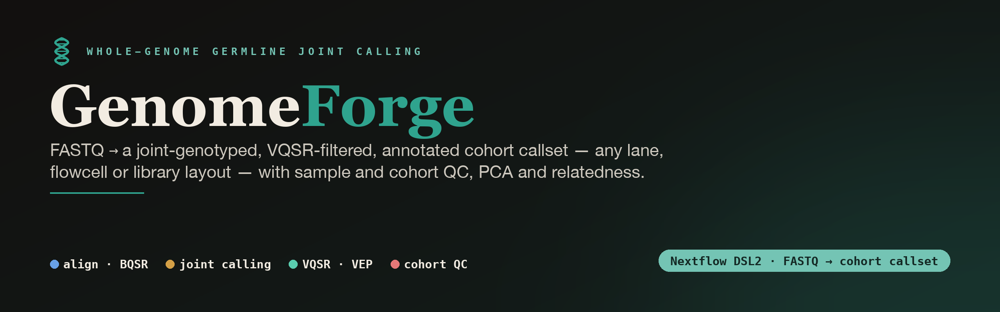
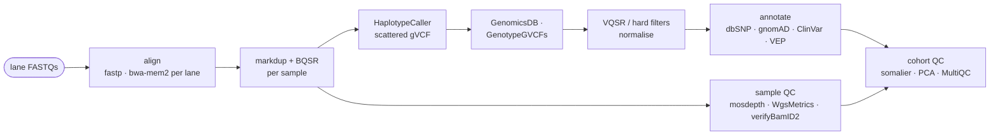

<!-- banner -->


<p align="center">
  
  
  
  
  
</p>

<p align="center"><b>A reproducible Nextflow pipeline for whole-genome germline analysis —<br>FASTQ to a joint-genotyped, VQSR-filtered, annotated and QC'd cohort callset.</b></p>

---

## Overview

GenomeForge takes paired-end Illumina whole-genome FASTQs, in any lane, flowcell, library or delivery layout, through alignment, duplicate marking, base-quality recalibration, scattered gVCF calling, joint genotyping, variant-quality recalibration, annotation and cohort QC. It is cohort- and site-agnostic: a sample sheet and a site profile describe the data and the cluster, and nothing in the workflow is edited between projects.

GenomeForge is the **whole-genome** sibling of **[CallForge](https://github.com/aduton1000/callforge)**, the targeted-panel pipeline. It runs on the same container images and reference bundle, so a site that has deployed CallForge can run GenomeForge without building anything new.

## Pipeline



## Features

- **Any lane layout.** One sample sheet row per lane-pair; samples may span lanes, flowcells, libraries and deliveries. Each lane is aligned with its own read group (`ID`, `SM`, `LB`, `PU`, `PL`, optional `CN`) and merged inside MarkDuplicates.
- **GATK best-practice germline calling.** bwa-mem2 → MarkDuplicates → BQSR → HaplotypeCaller `-ERC GVCF` scattered over the GATK WGS calling regions → GenomicsDBImport → GenotypeGVCFs → VQSR (SNP and INDEL), with an automatic fallback to GATK hard filters when the training sets are absent.
- **Annotation that scales.** Per-chromosome scatter of dbSNP rsIDs, gnomAD allele frequencies, ClinVar and VEP; multi-allelics split and left-aligned first; a flat per-variant TSV next to the annotated VCF.
- **Cohort QC that flags, never drops.** Depth, duplicate rate, contamination (verifyBamID2), sex concordance from coverage and from somalier, relatedness, Ti/Tv, plus plink2 PCA and a MultiQC report; a one-row-per-sample summary with explicit flags.
- **Reusable intermediates.** Per-sample whole-genome gVCFs are published for future joint calls; final BAMs can be archived as CRAM.
- **Reproducible.** Pinned containers, `versions.txt` and `params.json` on every run, resumable from any failure, scratch kept on disk (never a RAM-backed `/tmp`).
- **Robust sample-sheet builder.** Recognises Novogene, bcl2fastq and generic FASTQ names, reads flowcell and lane from read headers when the name lacks them, and refuses unpaired, truncated or unreadable files.

## Requirements

- **Nextflow** ≥ 24.10 (Java 17+).
- **SLURM** with **Apptainer** or **Singularity**.
- The four **CallForge images** (`callforge.sif`, `callforge-annotate.sif`, `callforge-cohortqc.sif`, `callforge-burden.sif`), built from the [CallForge](https://github.com/aduton1000/callforge) `env/` definitions.
- A **reference bundle**: chr-style no-alt GRCh38 with bwa-mem2 index, `.fai` and `.dict`; dbSNP, Mills and known-indels VCFs; hapmap, omni and 1000G phase-1 SNPs (VQSR); ClinVar; per-chromosome gnomAD sites; a somalier sites VCF; a VEP cache. See [`docs/hpc_deployment.md`](docs/hpc_deployment.md).

## Installation

```bash
git clone https://github.com/aduton1000/genomeforge.git /opt/genomeforge      # or ~/genomeforge
cd /opt/genomeforge
pip install -e .            # registers the `genomeforge` command
genomeforge --version       # success: prints "genomeforge 0.1.0"
```

On a Debian/Ubuntu system Python, `pip install` is refused (PEP 668 "externally managed
environment"). Either put `share/bin` on `PATH` (the `genomeforge` shim runs straight from
the checkout with no dependencies) or install into a virtual environment:

```bash
export PATH=/opt/genomeforge/share/bin:$PATH                       # option A: shim, nothing to install
python3 -m venv /opt/genomeforge/cli-env && /opt/genomeforge/cli-env/bin/pip install -e /opt/genomeforge   # option B
```
 A site fills in [`share/genomeforge-env.sh.example`](share/genomeforge-env.sh.example)
once (install root, profile, params file, run directory) and sources it from `~/.bashrc`.

A run selects a **site profile**: `slurm` (generic; pair it with a copy of [`params.example.yaml`](params.example.yaml)) or a bundled site profile such as `noguchi` (paths, partition and images built in; add your own as `conf/<site>.config`).

## Quickstart

```bash
genomeforge test                                                    # installation check: full DAG in stub mode
genomeforge check --profile noguchi                                 # references, containers, tools present?
genomeforge resources fetch /path/to/annotation_db                  # VQSR training sets + GATK calling regions (once per site)
genomeforge samplesheet --roots /data/delivery --metadata phenotypes.csv --out samplesheet.csv
genomeforge run --profile noguchi --input samplesheet.csv --rundir /data/projects/my-cohort/genomeforge_run --stub   # dry run
genomeforge run --profile noguchi --input samplesheet.csv --rundir /data/projects/my-cohort/genomeforge_run          # the run
genomeforge status --rundir /data/projects/my-cohort/genomeforge_run
```

`genomeforge run` submits the Nextflow head job under `sbatch` so it survives logout, keeps
`work/`, `tmp/`, `logs/` and `results/` under the run directory, and resumes when the same
command is repeated after a failure. Set `GENOMEFORGE_PROFILE`, `GENOMEFORGE_PARAMS` and
`GENOMEFORGE_RUNDIR` once (the env file does this) and the commands shrink to
`genomeforge run --input samplesheet.csv`.

## Usage

| command | purpose |
|:--------|:--------|
| `genomeforge run` | launch or resume the pipeline; every pipeline parameter passes through (`--scatter_count 8`, `--filtering hard`, …) |
| `genomeforge samplesheet` | lane-level sample sheet from FASTQ directories (Novogene, bcl2fastq or generic names) or from a `sample_id,fastq_1,fastq_2` CSV |
| `genomeforge check` | verify a site: tools, containers, FASTA + bwa-mem2 index, every VCF and index, gnomAD files, VEP cache, contig-style agreement |
| `genomeforge resources fetch DEST` | download hapmap / omni / 1000G (VQSR) and `wgs_calling_regions.hg38.interval_list` |
| `genomeforge status` | head job, task counts per process, recent log lines, results present |
| `genomeforge qc-summary` | rebuild `cohort_qc_summary.tsv/.md` from a results directory with other thresholds |
| `genomeforge test` | compile and dry-run the whole DAG on a synthetic layout |

`genomeforge <command> --help` documents every option with examples. The raw forms still
work: `nextflow run main.nf -profile noguchi --input samplesheet.csv` and `python3 bin/make_samplesheet.py …`.

**Sample sheet.** One row per lane-pair: `sample_id,lane_id,library,flowcell,lane,fastq_1,fastq_2[,sex,phenotype]`.
`clinical.csv` (optional) needs a `sample_id` column; `sex` (M/F) drives the sex-concordance check and `phenotype` is carried into the QC table.

**Key pipeline parameters** (all in [`nextflow.config`](nextflow.config); pass them to `genomeforge run`):

| option | default | purpose |
|:-------|:--------|:--------|
| `--scatter_count` | 48 | HaplotypeCaller / joint-genotyping shards |
| `--calling_regions` | site profile | GATK `wgs_calling_regions.hg38.interval_list`; falls back to whole primary chromosomes |
| `--filtering` | `vqsr` | `hard` for GATK hard filters; automatic fallback if training sets are missing |
| `--snp_tranche` / `--indel_tranche` | 99.7 / 99.7 | VQSR truth-sensitivity levels |
| `--trim` | `true` | fastp streamed into bwa-mem2 (no trimmed FASTQs written) |
| `--sequencing_center` | null | read-group `CN` tag |
| `--gnomad_pattern` / `--gnomad_fields` | exomes v4.1 / `AF,AF_afr,AF_grpmax,nhomalt` | gnomAD file template and INFO fields copied |
| `--run_vep` / `--run_pca` / `--run_contamination` | `true` | switch stages off |
| `--archive_cram` | `false` | CRAM next to each final BAM |
| `--qc_min_depth` / `--qc_max_dup` / `--qc_max_contam` / `--qc_min_mapped` | 20 / 0.25 / 0.03 / 0.95 | QC flag thresholds |

Per-process resources live in [`conf/base.config`](conf/base.config); memory and time scale with the retry attempt.

## Inputs and outputs

**Inputs.** A lane-level sample sheet, a chr-style no-alt GRCh38 with bwa-mem2 index, and the annotation bundle listed under *Requirements*. Required parameters: `--input` plus the site profile (or `--fasta`, `--dbsnp`, `--mills`, `--known_indels`, `--clinvar`, `--gnomad_dir`, `--somalier_sites`, `--vep_cache` and the container paths).

**Outputs (`results/`).** Analysis-ready BAMs (`02_bams/`); per-sample gVCFs (`04_gvcf/`); the raw, VQSR-filtered, normalised and PASS cohort VCFs with tranche files (`05_joint/`); the annotated VCF and `variants.flat.tsv.gz` (`06_annotated/`); `cohort_qc_summary.tsv`, somalier relatedness and sex, plink2 PCA, bcftools stats and `cohort_multiqc.html` (`07_cohort/`); per-sample QC (`03_qc/`); and `pipeline_info/` with the resource check, scatter intervals, `versions.txt`, `params.json`, trace, timeline and DAG. Details in [`docs/outputs_overview.md`](docs/outputs_overview.md).

## Documentation

- **HPC deployment**: [`docs/hpc_deployment.md`](docs/hpc_deployment.md) — images, reference bundle, site profiles, running, monitoring, troubleshooting.
- **Outputs overview**: [`docs/outputs_overview.md`](docs/outputs_overview.md) — what a run produces and how to read the QC summary.
- **Design notes**: [`docs/decisions.md`](docs/decisions.md) — choices made, their rationale, and what to revisit on real data.

## GenomeForge and CallForge

**[CallForge](https://github.com/aduton1000/callforge)** analyses targeted-capture panels designed by **[CaptureForge](https://github.com/aduton1000/captureforge)**; GenomeForge analyses whole genomes. They share images, references and output conventions, and GenomeForge's annotated VCF and gVCFs feed CallForge's `anno`, `cohortqc` and `burden` subcommands. Each runs independently.

## Citation, license, and issues

- **Cite**: see [`CITATION.cff`](CITATION.cff).
- **License**: MIT — see [`LICENSE`](LICENSE).
- **Issues / contributions**: open an issue or pull request on the [GitHub repository](https://github.com/aduton1000/genomeforge).
